<h1 align="center">Knob Hub</h1>

<p align="center">
  A turnable, touchable knob for your PC, with apps that run on the PC.<br />
  Runs on round ESP32 knob displays of any size: ready-made ones like Elecrow's CrowPanel, or your own build.
</p>

<p align="center">
  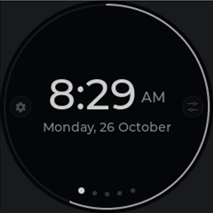
  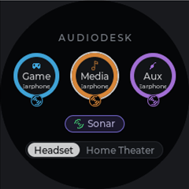
  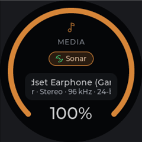
  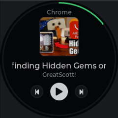
  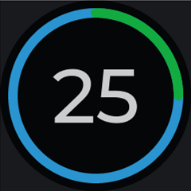
  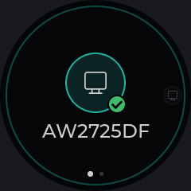
  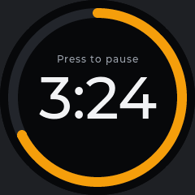
</p>

---

The knob is a round touch screen inside a ring you turn and press. Depending on the board it can also have RGB LEDs,
a vibration motor or a motor on the knob itself (see [Knobs](#knobs)). Its firmware, **Knob OS**, is a small launcher: a ring of pages (Clock, your apps, Settings) that you turn through. The apps
themselves run on the PC inside **Knob Hub**, a tray app that sends the knob what to draw and gets back what you did.
[AudioDesk](https://github.com/Shyam-Sangeeth/AudioDesk) was the first app; anyone can write more.

## Contents

- [Getting started](#getting-started)
- [How it works](#how-it-works)
- [Knobs](#knobs)
  - [Adding a board](#adding-a-board)
- [The knob](#the-knob)
  - [Home ring](#home-ring)
  - [AudioDesk](#audiodesk)
  - [Media](#media)
  - [Counter](#counter)
  - [Displays](#displays)
  - [Timer](#timer)
  - [Settings](#settings)
  - [Alerts and messages](#alerts-and-messages)
  - [Using the knob](#using-the-knob)
- [Knob Hub on the PC](#knob-hub-on-the-pc)
- [Apps](#apps)
- [Making an app](#making-an-app)
- [Designs](#designs)
- [Building and running](#building-and-running)
- [Files](#files)
- [Connection](#connection)
- [Repository layout](#repository-layout)
- [Status](#status)

## Getting started

1. **Install Knob Hub:** download `KnobHub-<version>-x64.msi` from the
   [latest release](https://github.com/Shyam-Sangeeth/KnobHub/releases/latest) and run it. It installs for everyone
   on the PC (Windows asks for admin rights), into Program Files unless you choose another folder, and starts Knob Hub
   when it's done. It needs 64-bit Windows 10 (2004 or later) or Windows 11; .NET comes with it.
2. **Put Knob OS on the knob:** plug the knob into the PC over USB, open Knob Hub's **Settings** page, and under
   **Knob OS** choose the knob's board and click **Install Knob OS**. It takes about a minute; then the knob restarts
   with Knob OS and connects. A CrowPanel straight from the box runs Elecrow's demo, which this replaces.
3. **Add apps:** Media is built in. **Apps > Add apps** lists the others (AudioDesk, Counter, Displays, Timer and more).

Knob Hub checks for a newer version of itself a little after it starts, and each new Knob Hub brings the newest
Knob OS: see [Updates](#updates).

## How it works

```
 Knob (ESP32-S3)              Knob Hub (PC tray app)                 e.g. AudioDesk
┌───────────────┐   JSON    ┌──────────────────────────────┐  its   ┌──────────────┐
│ Knob OS       │◄─────────►│ apps (plugins) build screens │◄──────►│ the program  │
│ draws screens,│   lines   │ and react to what you do     │  API   │ the app      │
│ sends input   │           │                              │        │ controls     │
└───────────────┘           └──────────────────────────────┘        └──────────────┘
```

- **The knob runs no apps.** Knob Hub sends it the list of apps, then screens to show: a template name plus data
  (dial, tiles, list, controls, ring, media). The knob draws them and reports what was done on them (turn, press,
  tap, select, back).
- **Each app is a Knob Hub plugin** that does the work on the PC. For example, the AudioDesk app turns knob input into
  calls to AudioDesk's local API.
- **Icons work the same way:** the knob asks for an icon by name at the size it shows it, and Knob Hub draws it (from
  the app's own icons or its built-in set) and sends it. Knob OS only has symbols for its own Clock and Settings.
- **So a new app, or a change to one, needs no firmware update**, as long as the templates fit it.
- **The knob remembers.** It keeps the app list and icons, so its Home ring is complete before Knob Hub connects
  (opening an app still needs Knob Hub). Every time Knob Hub connects, the knob checks for changes: a new app list
  replaces the kept one, icons an app now draws differently are fetched again, and icons of removed or turned-off
  apps are deleted.

The link is newline-delimited JSON, one message per line; every message is documented in
[`knob-os/src/core/link.h`](knob-os/src/core/link.h).

## Knobs

Knob Hub isn't made for one piece of hardware. Knob OS runs on any round ESP32 knob display that's in its list of
boards, and adding another is a small job (see [Adding a board](#adding-a-board)). Every knob has:

- a **round screen**, of any size;
- an **ESP32** (the boards so far are ESP32-S3s);
- a **knob to turn and press**: a rotary encoder, or a motor knob;
- a **touch screen** (some controls, such as Media's previous and next buttons, are touch only).

What else it has differs from board to board: RGB LEDs (how many), a vibration motor, a motor on the knob. A knob
tells Knob Hub which board it is and what it has when it connects. Knob Hub's Board page then shows only the settings
that board has, and its preview takes on the board's LEDs and motors (its screen is always 480 px).

The boards Knob OS knows now:

| Board | Screen | Has |
|---|---|---|
| Elecrow CrowPanel 1.28" | 240 x 240 | Touch, rotary encoder with press, 5 RGB LEDs |
| Elecrow CrowPanel 1.46" | 360 x 360 | Touch, rotary encoder with press, a ring of 8 RGB LEDs |
| Motor knob (planned, your own build) | 240 x 240 | Touch, a motor on the knob, a vibration motor, LEDs |

- **Screens scale.** Every screen is designed at 240 px and drawn at the knob's size, with fonts made for that size,
  so a 360 px knob shows the same layout, sharper. Apps don't change: they send the same screens to every knob.
- **Haptics,** on knobs that have them. A motor on the knob (like
  [SmartKnob](https://github.com/scottbez1/smartknob)) gives it clicks and end stops in software, set by each screen:
  firm clicks round the Home ring, a click per row with a stop at each end of a list, fine clicks with a hard stop at
  0 and 100% on a dial, a firm click per option on a picker. When a value changes on the PC (say the volume), the
  knob can turn itself to match. A vibration motor gives a click when you press and a buzz for alerts (and ticks and
  bumps when there's no motor on the knob). Settings > Haptics sets the strength and turns vibration on or off.
  The CrowPanels have no vibration motor of their own, but one can be added: plug DFRobot's
  [Gravity haptic motor driver for LRA motors](https://wiki.dfrobot.com/_SKU_DRI0056_Gravity_Haptic_Motor_Driver)
  (DRI0056, with its motor) into the knob's spare I2C connector, and Knob OS finds it when it starts.
- **Lights,** on knobs with LEDs. In **Level meter** mode they fill up, in order round the ring, with the level on the
  screen: a dial's or a channel's volume, how far a song has played, the seconds on the Clock (starting again each
  minute). A single LED gets brighter instead. Screens without a level (the other Home pages, lists) light them all. In **App colour** mode they all show the colour of the open app, or of
  the Home page in focus. LED brightness sets how bright.

### Adding a board

Apps don't change for a new board, and Knob Hub works with a knob whose board it doesn't know (it takes the screen
size, LEDs and motors from the knob's hello). To add one:

1. **List it** in `knob-os/src/core/boards.cpp`: an id (e.g. `crowpanel-1.46`), a name, the screen's diameter, and
   whether it has touch, how many LEDs, a vibration motor and a motor on the knob. Add the same line to
   `hub/KnobHub/Core/KnobBoard.cs`, so Knob Hub knows its name, and rebuild the preview DLL (`pio run -e preview`)
   so Knob Hub's preview can become it.
2. **Fonts:** if its screen size is new, add the size to `DIAMETERS` in `knob-os/fonts/make_fonts.py` and run it (see
   [Fonts](#fonts)).
3. **Pins:** a file in `knob-os/src/hal/esp32/boards/` with its id and pins (copy `crowpanel_1_46.h`), and any
   quirks the board has: the screen upside down, LEDs chained the other way round, or `WIFI_TX_POWER` when it can't
   join Wi-Fi at full transmit power, as the 1.46" can't.
4. **Build:** an env in `knob-os/platformio.ini` that extends `esp32` and sets `KNOB_BOARD` (the pin file) and
   `KNOB_FONT_SET` (the screen size), like `crowpanel-146`.
5. **Hardware layer:** if it uses a display, touch, LED or motor chip that `src/hal/esp32` doesn't drive yet, add a
   driver for it there. Knob OS's USB link is the ESP32-S3's own USB (GPIO 19 and 20, see `knob-os/platformio.ini`):
   a board whose USB port goes through a USB-to-serial chip needs the link on that chip's UART instead.

Then try it in the simulator (`--board <id>`) and Knob Hub's preview before flashing.

## The knob

Real screenshots from the Knob OS simulator, at the knob's actual size.

### Home ring

Turn the knob to move between pages; press to open one. Each app page shows its icon, name and subtitle in the app's
colour, with the neighbouring pages peeking in at the sides and dots for where you are.

<table>
  <tr>
    <td align="center"><br />Clock</td>
    <td align="center">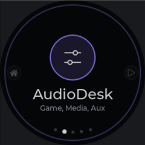<br />An app (AudioDesk)</td>
    <td align="center">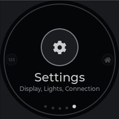<br />Settings</td>
  </tr>
</table>

### AudioDesk

Controls [AudioDesk](https://github.com/Shyam-Sangeeth/AudioDesk)'s Game, Media and Aux channels.

<table>
  <tr>
    <td align="center"><br />Channels</td>
    <td align="center"><br />A channel</td>
    <td align="center">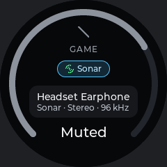<br />Muted</td>
    <td align="center">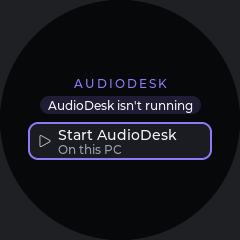<br />AudioDesk isn't running</td>
  </tr>
</table>

- **Channels:** each channel is a circle: a thin ring in the channel's colour, filled by a thicker arc as far as the
  volume (empty when muted), with the output device inside (Sonar's output while the channel goes through Sonar;
  long names scroll) and a small Sonar badge while it goes through Sonar. A muted channel's icon is crossed out.
  Below are a **Sonar** pill (when SteelSeries Sonar is installed) and **Headset | Home Theater**.
- **While AudioDesk switches** (a device, Sonar on or off, Headset | Home Theater), the screen dims and a spinner turns
  in the middle. Turning, pressing and tapping do nothing until it's done; going back (a long press or a swipe right)
  still works.
- **A channel** (press it): the volume ring with the % at the bottom (or "Muted"), the channel's own Sonar on/off,
  and its output device (name and format on a card; while it goes through Sonar, the devices Sonar can play it on).
  Pressing the knob moves between them, and turning changes the selected one:
  - volume, by the **Volume step** set for AudioDesk on Knob Hub's Apps page (1%, 2% by default, 5% or 10%);
  - Sonar on/off;
  - the next or previous device (it switches once you stop turning).

  Tap the icon or the volume %, or press the knob twice quickly, to mute.
- **Stays in step:** while a channel goes through Sonar the volume is Sonar's own for that channel, otherwise each
  app's volume in the Windows mixer. Changes made in AudioDesk show up on the knob and the other way round.
- **AudioDesk isn't running:** the knob says so, with a **Start AudioDesk** button when it can find AudioDesk on the
  PC (its Start with Windows entry or the installer's folder). When AudioDesk comes back, the knob returns to the
  screen you were on.

It talks to AudioDesk through AudioDesk's local API, so it needs AudioDesk **1.0.0 or newer** running, with
**Knob support** on in AudioDesk's Settings tab.

### Media

What's playing in Windows: album art, title and artist, and the app playing it. Press the knob to play or pause, tap
the on-screen buttons for previous and next, and turn the knob to seek 5 seconds per click. Titles in scripts the
knob's fonts don't have (Malayalam, Hindi, Japanese...) are drawn by Knob Hub with Windows' fonts and sent as
pictures.

<table>
  <tr>
    <td align="center"><br />Now playing</td>
    <td align="center">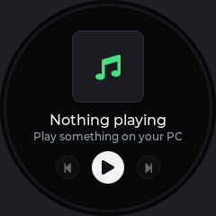<br />Nothing playing</td>
  </tr>
</table>

### Counter

A small example app. It opens at 0 and counts up by one for each click to the right and down by one for each click
to the left, never below 0. The number is drawn as big as fits in the middle of a ring that fills once every 20
counts; each new lap fills in a new random bright colour over the last one.

<table>
  <tr>
    <td align="center">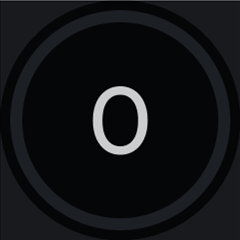<br />Start</td>
    <td align="center"><br />25: the second lap</td>
  </tr>
</table>

### Displays

Picks the main display: the one with the Start menu, the taskbar's clock and where new windows open. Each display
Windows shows the desktop on is a card with its monitor's name. The main display comes first, with a green tick,
then the others left to right as they're arranged. Turn the knob to go through them and press it (or tap the card)
to make the one on show the main display, like **Make this my main display** in Windows' Settings. The displays keep
their places round it, and the new main display moves to the front with the knob still on it. Windows may black out
the screens for a moment while it switches. Displays plugged in or out, or a main display chosen in Settings, show up
while the app is open.

<table>
  <tr>
    <td align="center"><br />The main display</td>
    <td align="center">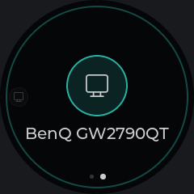<br />Another display: press to make it the main one</td>
  </tr>
</table>

### Timer

A countdown timer. Turn the knob to set it: a minute a click up to 15 minutes, five minutes a click up to an hour,
then a quarter of an hour a click up to 3 hours. Press to start: the ring empties as the time runs down, and the
knob's screen stays on (no timeout, no dimming) until it's done. Press again to pause, when the screen may sleep, and
once more to carry on; turning while it's paused sets it afresh. It keeps running when you go back to Home, and at
the end **Time's up** shows over whatever the knob shows, waking it (with a buzz on a knob with vibration).

<table>
  <tr>
    <td align="center">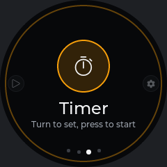<br />On the Home ring</td>
    <td align="center">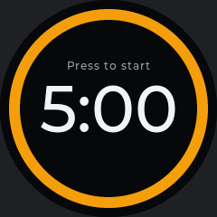<br />Set</td>
    <td align="center"><br />Running</td>
    <td align="center">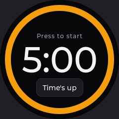<br />Done</td>
  </tr>
</table>

### Settings

The knob's own settings: Display (brightness, screen timeout), Lights (LED brightness and mode, on knobs with LEDs),
Haptics (strength and vibration, on knobs with a motor or a vibration motor), Connection (USB, Wi-Fi setup; Wi-Fi
says **Off on USB** while Knob Hub is connected over USB) and About. Knob Hub's Settings page has them too. The knob
keeps its settings itself, so it starts with them before Knob Hub connects. Settings changed on the knob while Knob
Hub isn't connected are kept: Knob Hub takes them when it connects (Knob OS 1.0.4 and Knob Hub 1.0.4 or newer).
Otherwise Knob Hub's saved settings are used, and a change on either side shows on the other.

Each row shows its setting under its name. Press a row to change it: brightness opens a dial, where turning sets it
and a press goes to the lowest (LEDs **Off**, the screen 5%, so it stays readable) and back to 100%.

**Screen timeout:** after the chosen time with nothing done on the knob, the screen turns off. The next turn, press or
touch only wakes it; it doesn't act. A message from Knob Hub (e.g. "Sonar is off") wakes it too, and the timeout starts
again; apps updating their screens don't. An app can keep the screen on while it needs it (Timer, while it runs):
then it doesn't time out or dim, and the timeout starts again when the app lets go. Settings > Connection and its
Wi-Fi screens keep it on the same way, since joining a network can take a minute. With **Dim when idle** on, the screen dims to a quarter of its brightness
halfway to the timeout (after a minute when the timeout is Never); while it's dimmed the knob works as usual. The LEDs
go off with the screen; with Lights > **When dimmed** set to off, they go off already when it dims. Knob Hub's preview
goes dark with the knob.

<table>
  <tr>
    <td align="center">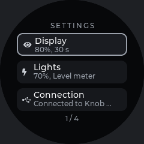<br />Settings</td>
    <td align="center">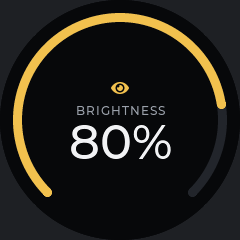<br />Screen brightness</td>
    <td align="center">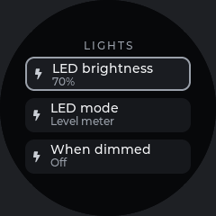<br />Lights</td>
    <td align="center">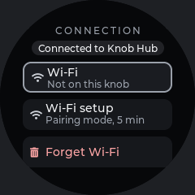<br />Connection</td>
  </tr>
</table>

### Alerts and messages

<table>
  <tr>
    <td align="center">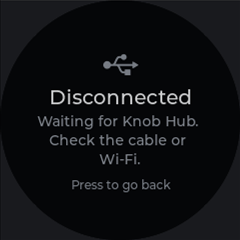<br />Knob Hub disconnected</td>
    <td align="center">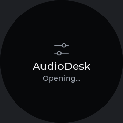<br />Opening an app</td>
    <td align="center">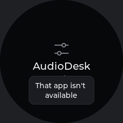<br />A toast</td>
  </tr>
</table>

Every screen, state and message is in [`design/screenshots/`](design/screenshots), grouped by app.

### Using the knob

| Do | On Home | Anywhere else |
|---|---|---|
| Turn | Next or previous page | Change the selected value or item |
| Press | Open the page | Select or toggle (in AudioDesk, move between controls) |
| Long press | | Back |
| Tap | | Tap a control |
| Swipe left / right | Turn pages | Swipe right: back |

While the screen is off (see [Settings](#settings)), the first turn, press or touch only wakes it.

## Knob Hub on the PC

Knob Hub lives in the tray. Its window has four pages, and works without a knob: the preview is then a virtual knob.
While the window is closed, minimized or on another page, the preview keeps up with the knob without drawing, so it
costs next to nothing and shows the knob's current screen as soon as you open it.

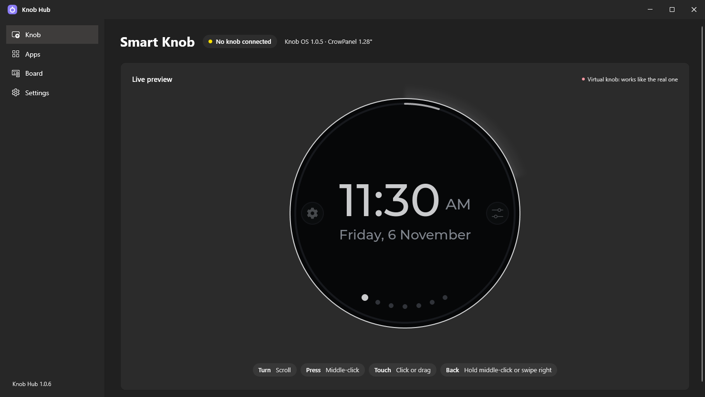

**Knob:** the knob's name, whether it's connected, its board, and a **live preview** of its screen. While a knob (or
the simulator) is connected, the preview mirrors it, and what you do in the preview happens on the knob. Scroll to
turn, middle-click to press (hold for back), click or drag to touch, swipe right for back. The preview is always
480 px, one pixel per screen pixel, drawn the way a 480 px knob would be: the same layout as every knob, sharp. Apart
from that it's the same board as the connected knob (or the last one). The knob's LEDs glow round it: a single LED as
a halo, several along the screen's progress arc, from where it starts to where it ends, one part per LED, so a level
fills the glow like the arc on the screen (the more LEDs, the finer). On a knob with haptics it says what the motor is
doing (e.g. "Motor: 51 fine detents, end stops") and its ring flashes when the knob would vibrate.

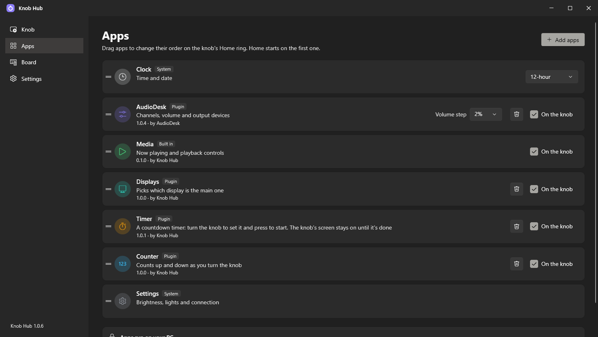

**Apps:** everything on the knob's Home ring, in order, Clock and Settings included. Drag a row to move it (Home
starts on the first one), turn apps on or off the knob, change their settings (e.g. AudioDesk's volume step or the
clock's 12/24-hour format), and remove plugins.

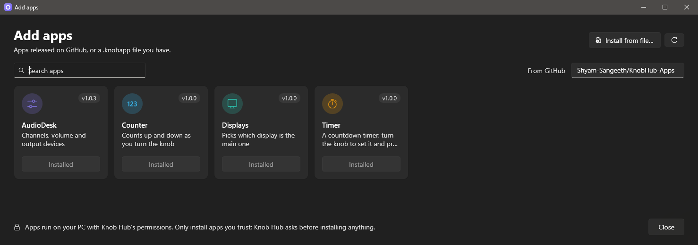

**Add apps** (on the Apps page) opens over Knob Hub and lists the apps released on GitHub, as tiles, with search.
Each tile shows the app's version; when a newer one is out it shows both (e.g. "v1.0.1 → v1.0.2") and the button
says **Update**. Install or update one from the list, or use **Install from file...** for a `.knobapp` you have.
Updates and removals take effect right away, without restarting Knob Hub. Knob Hub asks before
installing anything, because apps run with Knob Hub's permissions: only install apps you trust.

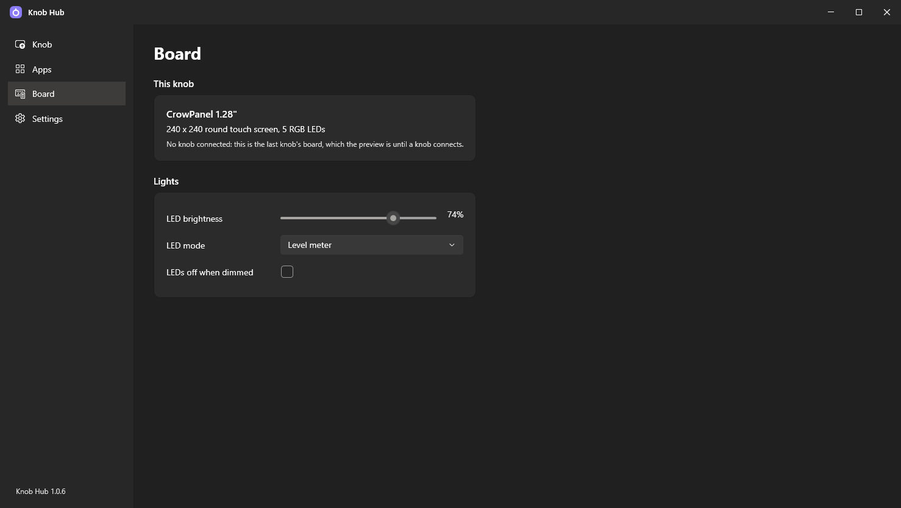

**Board:** which board the knob is and what it has (screen size, LEDs, motors), and the settings only some knobs
have: Lights (LED brightness and mode) on knobs with LEDs, and Haptics (strength, vibration) on knobs with a motor or
a vibration motor. The preview always has the board of the last knob that connected (the first board in the list,
the CrowPanel 1.28", until one does). To try another board, run the simulator as it (see [Simulator](#simulator)): Knob Hub's preview follows.

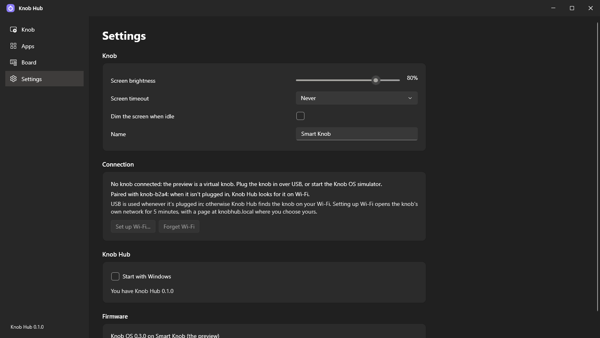

**Settings:** the knob's screen brightness, screen timeout, idle behaviour and name, the connection, and Start with
Windows. **Set up Wi-Fi...** (with a knob connected) opens a small window: the knob looks for networks, you pick
yours and type its password, and the knob joins it there and then. The password goes only to the knob. Meanwhile the
knob shows a Wi-Fi screen; using the knob closes the window. Once the knob has joined, it says so for 5 seconds,
then goes back to its Connection page and the window closes by itself. **Use a phone** in that window starts the knob's pairing
mode instead, and **Forget Wi-Fi** makes the knob forget its network (see [Connection](#connection)). **Knob OS**
says which Knob OS the knob runs and installs a newer one, and **Knob Hub** checks for a newer Knob Hub (see
[Updates](#updates)).

### Updates

- **Knob Hub** checks GitHub for a newer version a little after it starts (turn it off in Settings) and says so in
  a Windows notification. **Check for updates** in Settings checks now. **Download and install** fetches the
  installer, checks it against the release's SHA-256, and runs it: Knob Hub closes, updates and starts again, with
  its settings and apps kept. If GitHub doesn't give a SHA-256 for the installer, Knob Hub doesn't run it: download
  it from the releases page instead.
- **Knob OS** comes with Knob Hub, an image for each board. When the knob runs an older Knob OS than the one Knob Hub
  has, Settings > Knob OS offers to install it, and the knob shows "Knob OS 1.0.5 is ready: see Knob Hub" once when
  it connects. Installing needs the knob plugged in over USB (over Wi-Fi, Settings asks you to plug it in). The knob
  keeps its settings, its pairing and its Wi-Fi network. Knob Hub restarts it into the ESP32-S3's own loader through
  USB, so no buttons are needed, writes Knob OS, checks what it wrote, and restarts it.
- **A knob that isn't running Knob OS** (new, or one whose Knob OS doesn't start) can't say what board it is: while
  the Settings page is open, Knob Hub notices it on its USB port and lets you choose the board, then installs
  Knob OS on it. A knob whose Knob OS doesn't start doesn't show up on USB at all: hold its boot button while you
  plug it in, so it starts in its loader, and Knob Hub offers to install Knob OS.
- **Apps** update from **Add apps** (see [Apps](#apps)).

## Apps

| App | What it does | Where it comes from |
|---|---|---|
| Media | Now playing in Windows, playback controls | Built into Knob Hub |
| AudioDesk | AudioDesk's channels, volume, Sonar and output devices | [KnobHub-Apps](https://github.com/Shyam-Sangeeth/KnobHub-Apps) (source in `hub/Plugins/AudioDesk`) |
| Counter | Counts up and down as you turn | [KnobHub-Apps](https://github.com/Shyam-Sangeeth/KnobHub-Apps) (source in `hub/Plugins/Counter`) |
| Displays | Picks the main display | [KnobHub-Apps](https://github.com/Shyam-Sangeeth/KnobHub-Apps) (source in `hub/Plugins/Displays`) |
| Timer | A countdown timer that keeps the screen on while it runs | [KnobHub-Apps](https://github.com/Shyam-Sangeeth/KnobHub-Apps) (source in `hub/Plugins/Timer`) |

Apps are released in their own repository, [Shyam-Sangeeth/KnobHub-Apps](https://github.com/Shyam-Sangeeth/KnobHub-Apps),
apart from Knob Hub's releases. Each app there has one release, tagged with its id, holding every version as
`<id>-<version>.knobapp` and `<id>-<version>.app.json`; Add apps lists the newest version of each. To publish, run
`hub/Plugins/pack-release.ps1`: it builds every app in `hub/Plugins` and adds the versions not released yet to
their apps' releases (it needs the GitHub CLI, logged in). Bump `version` in an app's `app.json` to publish an update.

## Making an app

**The full guide is the [KnobHub-Apps wiki](https://github.com/Shyam-Sangeeth/KnobHub-Apps/wiki)**: setting up, a step-by-step tutorial, every screen with
pictures, icons, testing, publishing, design guidelines and troubleshooting, plus a [page for AI agents](https://github.com/Shyam-Sangeeth/KnobHub-Apps/wiki/For-AI-agents).
In short:

An app is a Knob Hub plugin: a folder with `app.json` and a .NET assembly, zipped and renamed to `.knobapp`. Knob
Hub installs it into `%LOCALAPPDATA%\KnobHub\Apps\<id>`. `hub/Plugins/Counter` is a small, complete example.

**`app.json`:** `id`, `name`, `subtitle`, `description`, `icon`, `color`, `version`, `author`, `assembly` (the DLL's
file name) and `type` (full name of the `KnobApp` subclass).

**The app** derives from `KnobHub.Sdk.KnobApp`: override `Open` to show the first screen and `Input` to react
(optionally `Start`, `Stop` and `Closed`). It talks to the knob through `IKnobHost`: `Show`, `Update`, `Close`,
`Toast`, `KeepAwake` (the knob's screen stays on while it's on, e.g. while a timer runs) and `Log`. Knobs come in different sizes, but screens scale by themselves; only a picture an app draws itself
needs sizing, for a 240 px screen times `Host.ScreenSize / 240.0`.

**Screens** are templates the knob already knows:

| Screen | For |
|---|---|
| `DialScreen` | One big value |
| `TilesScreen` | Up to three round tiles with pills (AudioDesk's channels) |
| `ListScreen` | Rows |
| `ControlsScreen` | A value with a toggle and a picker (an AudioDesk channel) |
| `RingScreen` | A number in the middle of a full ring, drawn as big as fits (Counter) |
| `CardsScreen` | One item at a time, like an app's page on Home, with a tick on the current one (Displays) |
| `MediaScreen` | Now playing |

**Icons** are names. Knob Hub has common ones built in (music, play, pause, game, headphones, speaker, volume, mic,
tv, settings, clock, lights, wifi, star, heart and more). Add your own by overriding `Icons`: name to
`KnobIcon.Glyph(text, font)`, `KnobIcon.Image(pngBytes)` or `KnobIcon.Path(svgPathData)`. Knob Hub draws them at the
size the knob asks for. Names are shared between apps, so prefix yours (e.g. `myapp.logo`).

**Settings:** override `Settings` to list them (`AppSetting(id, label, options, default)`, a drop-down of options).
Knob Hub shows them on the app's row on the Apps page and saves the choice in `settings.json`. Read the chosen
option's index with `Host.Setting(id)`; `SettingChanged(id)` is called when it changes.

Build with `dotnet build -c Release`: it produces `bin\Release\<name>.knobapp`, ready for **Install from file...**

## Designs

[`design/recreated/`](design/recreated) has every knob screen recreated by hand in HTML and CSS, one page per app
(home, audiodesk, media, counter, settings, system), drawn at 2x from the screenshots in
[`design/screenshots/`](design/screenshots) with Knob OS's colours and font (Montserrat). They're editable starting
points for new screens and apps. Download a page and open it in a browser to see it (GitHub shows the source).

## Building and running

### Simulator

Prerequisites:

- PlatformIO
- SDL2 MinGW development package unpacked to `%USERPROFILE%\.tools\SDL2\SDL2-2.30.9` (from
  https://github.com/libsdl-org/SDL/releases, file `SDL2-devel-2.30.9-mingw.tar.gz`)
- 64-bit MinGW gcc in `%USERPROFILE%\.mingw64\bin`

In `knob-os`:

```bash
pio run -e sim -t exec
```

Build output goes to `%USERPROFILE%\.cache\knob-os`. In the simulator, the mouse wheel turns, middle click presses
(held half a second = back), the left button touches (tap, swipe), and swiping right goes back. It can be any board
in the list: run `program.exe --board <id>` from `%USERPROFILE%\.cache\knob-os\build\sim`, with an id from
[Knobs](#knobs) (`crowpanel-1.28`, the default, `crowpanel-1.46` or `motor-knob`). It prints what a knob's motors and LEDs would do in its log window.

### Knob Hub

In `hub`:

```bash
dotnet build KnobHub\KnobHub.csproj
KnobHub\bin\Debug\net10.0-windows10.0.19041.0\KnobHub.exe
```

Building Knob Hub also builds `knob_preview.dll` (`pio run -e preview`) if it's missing and copies it next to the
app, with the Knob OS images from the last real-knob builds (see [The real knob](#the-real-knob)). Knob Hub connects
to the simulator on 127.0.0.1:5718 and retries every 2 seconds.

### Installer and releases

```powershell
powershell -ExecutionPolicy Bypass -File installer\build-installer.ps1
```

builds Knob OS for every board and the preview, a self-contained Knob Hub, and in `installer\out` the installer
(`KnobHub-<version>-x64.msi`, the version from `hub\KnobHub\KnobHub.csproj`) and each board's Knob OS image
(`knob-os-<version>-<board>.bin`). A release is a GitHub release tagged `v<version>` with all of them attached; Knob
Hub's updater looks for its `.msi`. `installer\make-installer-art.ps1` draws the installer's pictures. Apps are
released separately (see [Apps](#apps)).

### Checks

`python -I tools/checks.py` checks Knob OS's behaviour (LEDs, pictures, haptics, toasts, the screen timeout, cards, the Wi-Fi screen, the busy spinner, keeping the screen awake) through
the preview DLL, without a knob. `tools/tour.py` and `tools/compare.py` show whether a change altered any screen. See
[`tools/README.md`](tools/README.md).

### The real knob

```bash
pio run -e crowpanel-128    # CrowPanel 1.28"
pio run -e crowpanel-146    # CrowPanel 1.46"
```

builds Knob OS for one board: there's an env per board (its pins and quirks are in `knob-os/src/hal/esp32/boards/`).
Add `-t upload --upload-port COM7` (the knob's port, "USB Serial Device" in Device Manager) to flash it. Close Knob
Hub first, because it holds the port. PlatformIO opens the port at 1200 baud, which restarts the knob into its loader,
then flashes it on the loader's port, which appears in its place. Both CrowPanels run
it: display, touch, encoder and press, backlight, LEDs, the USB and Wi-Fi links, and vibration through an add-on
haptic driver. The motor on the knob is still to be written.

Each build also makes `knob-os.bin`: the bootloader, the partition table and Knob OS in one image that starts at 0x0
(`knob-os/scripts/merged.py`). It's copied to `%USERPROFILE%\.cache\knob-os\firmware\`, with `firmware.json` saying
each board's file and Knob OS version; building Knob Hub copies that folder next to it, and Settings > Knob OS
installs from it. To flash a release's image by hand, put the knob in its loader first: hold its boot button while
you plug it in (esptool can't restart Knob OS 1.0.5 into it). Then use
`esptool --chip esp32s3 --port COM3 write-flash 0x0 knob-os-1.0.5-crowpanel-1.28.bin`, with the port the loader is on
("USB JTAG/serial debug unit"). Unlike Knob Hub, that also clears the knob's pairing and Wi-Fi network.

How fast a knob draws: build with `-D KNOB_PERF` and run `tools/knob_perf.py` (see [`tools/README.md`](tools/README.md)).
A whole-screen frame takes about 25 ms on the 1.28".

### Fonts

`knob-os/fonts/make_fonts.py` builds `src/core/fonts/knob_font_*.c` (Montserrat Medium, LVGL symbols, Latin-1,
Latin Extended-A and typographic punctuation) and digits-only fonts for big numbers, at every size the screens use
for each screen size in `DIAMETERS` (the boards' 240 and 360 px, and 480 for Knob Hub's preview), with `npx lv_font_conv@1.5.3`, plus
`fonts.cpp`, which maps a screen's design size to the font for the knob's screen. A knob's build keeps only its own
screen size's fonts. It needs Node.js.

## Files

- Knob Hub itself: `C:\Program Files\Knob Hub` unless you chose another folder, with the Knob OS images it installs
  in `firmware\`. Uninstalling keeps the settings and apps below.
- Settings: `%LOCALAPPDATA%\KnobHub\settings.json`
- Installed apps: `%LOCALAPPDATA%\KnobHub\Apps\<id>`
- Log: `%LOCALAPPDATA%\KnobHub\knobhub.log` (connections, apps opened, app problems)
- The simulator's kept data, its stand-in for the knob's flash: `%LOCALAPPDATA%\KnobHub\Simulator\` (`apps.json`,
  `icons.bin`, `settings.json`). The real knob keeps the same files in its flash.

## Connection

- **USB:** the knob shows up in Windows under its own name (e.g. "Smart Knob", set in Knob Hub's Settings), as a USB
  serial port of Knob OS's own on the ESP32-S3's USB. A new name shows after the knob restarts; one that has never had
  a name shows as "Knob Hub knob". Names are kept to plain letters, digits and punctuation for USB.
  Knob Hub looks only at ports with Espressif's USB vendor id (303A), so it never opens other serial devices, and
  counts a port as the knob once it says hello. A port that doesn't is left alone for 30 seconds. Unplug and plug back
  in at any time: Windows doesn't list the knob under Safely Remove Hardware (only briefly while Knob OS is being
  installed, as "USB JTAG/serial debug unit": the knob's loader). Knob Hub sends the knob a heartbeat
  (with the time, for its clock) every 2 seconds, which is how the knob knows the link is up.
- **Installing Knob OS** goes through the ESP32-S3's built-in USB unit, which the loader uses: while Knob OS is
  being installed the knob is a different COM port, "USB JTAG/serial debug unit" (and in Safely Remove Hardware for
  that minute). Knob OS 1.0.1 and earlier used that unit all the time.
- **USB always has priority:** when the knob is plugged in, Knob Hub switches to it from Wi-Fi or the simulator, and
  back when it's unplugged. While Knob Hub is connected over USB the knob's Wi-Fi is off (Settings > Connection says
  **Off on USB**). It comes on for what Knob Hub's Wi-Fi window asks (looking for networks, joining one, pairing
  mode) and when the USB link goes: unplug the knob or close Knob Hub, and it joins your network again in a few
  seconds. Plugged into a charger without Knob Hub, it stays on Wi-Fi.
- **Pairing:** the first time a knob says hello over USB, Knob Hub gives it a random key. Over Wi-Fi both prove they
  hold it before anything else, and every line is encrypted (AES-256-GCM) with a key new for each connection. One
  knob is paired at a time: plugging in another pairs that one instead, and plugging the first back in pairs it again.
- **Wi-Fi:** the knob listens on your network as `knob-xxxx.local`, and Knob Hub connects to the paired knob there
  whenever it isn't plugged in. Your router lists it under the knob's name.
- **Setting up Wi-Fi,** two ways (the knob uses 2.4 GHz networks only):
  - From Knob Hub, with the knob connected: **Set up Wi-Fi...** on the Settings page lists the networks the knob can
    see; pick yours and type its password (see [Knob Hub on the PC](#knob-hub-on-the-pc)).
  - Without the PC: the knob's Settings > Connection > Wi-Fi setup (or **Use a phone** in Knob Hub's window) starts
    pairing mode. The knob opens its own network (`KnobHub-xxxx`, with the password on its screen) for 5 minutes,
    and a page at knobhub.local where you choose your network from a phone. The knob's network switches off once it
    has joined yours.
- **When the knob can't join,** Knob Hub's Wi-Fi window says why: the password was turned down, the knob can't see
  the network (it needs 2.4 GHz), the security isn't WPA2 or WPA3, or the network didn't answer in time. The knob
  keeps trying for a minute. Knob Hub's log has the knob's Wi-Fi reason code too (for example "Wi-Fi reason 2" when
  the router didn't answer), which helps when the reason isn't clear.

## Repository layout

```
KnobHub/
├─ knob-os/                 Knob OS firmware (PlatformIO, LVGL 9.2, C++17)
│  ├─ src/core/             Shared UI and logic: Home ring, templates, settings, link, icon cache, boards, haptics,
│  │                        LEDs, screen timeout
│  ├─ src/hal/sim/          Simulator (SDL2 window)
│  ├─ src/hal/preview/      knob_preview.dll for Knob Hub's live preview
│  ├─ src/hal/esp32/        The real knob (net.cpp: Wi-Fi and pairing); boards/ has each board's pins
│  ├─ variants/knob/        The ESP32-S3 variant with Knob OS's own USB product id (303A:0002)
│  └─ fonts/                make_fonts.py
├─ hub/                     Knob Hub (WPF, .NET 10); KnobHub.slnx
│  ├─ KnobHub.Sdk/          Class library for apps
│  ├─ KnobHub/              The tray app
│  └─ Plugins/              AudioDesk, Counter, Displays and Timer apps, pack-release.ps1
├─ design/
│  ├─ screenshots/          Every knob screen, by app
│  └─ recreated/            The screens recreated in HTML/CSS, one page per app
├─ installer/               Knob Hub's installer (WiX) and build-installer.ps1, which makes a release's files
├─ docs/screenshots/        Knob Hub screenshots for this README
└─ tools/                   Checks through the preview DLL, screen tours, simulator and Knob Hub screenshots
```

## Status

Working: Knob OS on both CrowPanels (1.28" and 1.46"), over USB and Wi-Fi, the simulator, Knob Hub with the live
preview, its installer and updates, installing Knob OS from Knob Hub, apps from GitHub, and the Media, AudioDesk,
Counter, Displays and Timer apps, with haptics (vibration through an add-on driver), the LEDs' modes and the screen timeout. Next: the motor knob (a motor on the knob, driven by
field-oriented control).
