<h1 align="center">Knob Hub</h1>

<p align="center">
  A turnable, touchable knob for your PC, with apps that run on the PC.<br />
  Built on the Elecrow CrowPanel 1.28" ESP32-S3 rotary display.
</p>

<p align="center">
  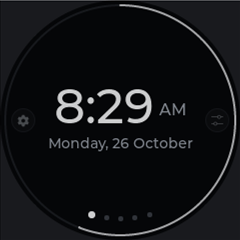
  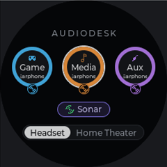
  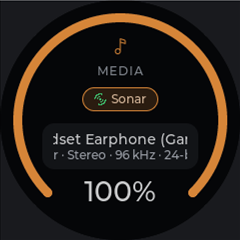
  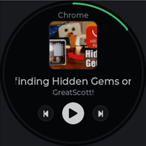
  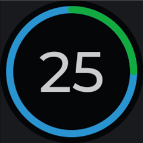
</p>

---

The knob is a round 240 x 240 touch screen inside a ring you turn and press, with 5 RGB LEDs and Wi-Fi. Its firmware,
**Knob OS**, is a small launcher: a ring of pages (Clock, your apps, Settings) that you turn through. The apps
themselves run on the PC inside **Knob Hub**, a tray app that sends the knob what to draw and gets back what you did.
[AudioDesk](https://github.com/Shyam-Sangeeth/AudioDesk) was the first app; anyone can write more.

## Contents

- [How it works](#how-it-works)
- [The knob](#the-knob)
  - [Home ring](#home-ring)
  - [AudioDesk](#audiodesk)
  - [Media](#media)
  - [Counter](#counter)
  - [Settings](#settings)
  - [Alerts and messages](#alerts-and-messages)
  - [Using the knob](#using-the-knob)
- [Knob Hub on the PC](#knob-hub-on-the-pc)
- [Apps](#apps)
- [Making an app](#making-an-app)
- [Designs](#designs)
- [Building and running](#building-and-running)
- [Files](#files)
- [Connection](#connection)
- [Repository layout](#repository-layout)
- [Status](#status)

## How it works

```
 Knob (ESP32-S3)              Knob Hub (PC tray app)                 e.g. AudioDesk
┌───────────────┐   JSON    ┌──────────────────────────────┐  its   ┌──────────────┐
│ Knob OS       │◄─────────►│ apps (plugins) build screens │◄──────►│ the program  │
│ draws screens,│   lines   │ and react to what you do     │  API   │ the app      │
│ sends input   │           │                              │        │ controls     │
└───────────────┘           └──────────────────────────────┘        └──────────────┘
```

- **The knob runs no apps.** Knob Hub sends it the list of apps, then screens to show: a template name plus data
  (dial, tiles, list, controls, ring, media). The knob draws them and reports what was done on them (turn, press,
  tap, select, back).
- **Each app is a Knob Hub plugin** that does the work on the PC. For example, the AudioDesk app turns knob input into
  calls to AudioDesk's local API.
- **Icons work the same way:** the knob asks for an icon by name at the size it shows it, and Knob Hub draws it (from
  the app's own icons or its built-in set) and sends it. Knob OS only has symbols for its own Clock and Settings.
- **So a new app, or a change to one, needs no firmware update**, as long as the templates fit it.
- **The knob remembers.** It keeps the app list and icons, so its Home ring is complete before Knob Hub connects
  (opening an app still needs Knob Hub). Every time Knob Hub connects, the knob checks for changes: a new app list
  replaces the kept one, icons an app now draws differently are fetched again, and icons of removed or turned-off
  apps are deleted.

The link is newline-delimited JSON, one message per line; every message is documented in
[`knob-os/src/core/link.h`](knob-os/src/core/link.h).

## The knob

Real screenshots from the Knob OS simulator, at the knob's actual size.

### Home ring

Turn the knob to move between pages; press to open one. Each app page shows its icon, name and subtitle in the app's
colour, with the neighbouring pages peeking in at the sides and dots for where you are.

<table>
  <tr>
    <td align="center"><br />Clock</td>
    <td align="center">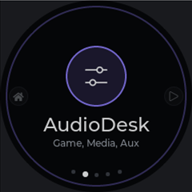<br />An app (AudioDesk)</td>
    <td align="center">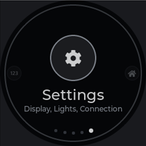<br />Settings</td>
  </tr>
</table>

### AudioDesk

Controls [AudioDesk](https://github.com/Shyam-Sangeeth/AudioDesk)'s Game, Media and Aux channels.

<table>
  <tr>
    <td align="center"><br />Channels</td>
    <td align="center"><br />A channel</td>
    <td align="center">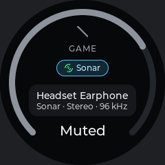<br />Muted</td>
    <td align="center"><br />AudioDesk isn't running</td>
  </tr>
</table>

- **Channels:** each channel is a circle: a thin ring in the channel's colour, filled by a thicker arc as far as the
  volume (empty when muted), with the output device inside (Sonar's output while the channel goes through Sonar;
  long names scroll) and a small Sonar badge while it goes through Sonar. A muted channel's icon is crossed out, and
  an arc spins round the ring while a channel switches device. Below are a **Sonar** pill (when SteelSeries Sonar is
  installed) and **Headset | Home Theater**.
- **A channel** (press it): the volume ring with the % at the bottom (or "Muted"), the channel's own Sonar on/off,
  and its output device (name and format on a card; while it goes through Sonar, the devices Sonar can play it on).
  Pressing the knob moves between them, and turning changes the selected one:
  - volume, by the **Volume step** set for AudioDesk on Knob Hub's Apps page (1%, 2% by default, 5% or 10%);
  - Sonar on/off;
  - the next or previous device (it switches once you stop turning).

  Tap the icon or the volume %, or press the knob twice quickly, to mute.
- **Stays in step:** while a channel goes through Sonar the volume is Sonar's own for that channel, otherwise each
  app's volume in the Windows mixer. Changes made in AudioDesk show up on the knob and the other way round.
- **AudioDesk isn't running:** the knob says so, with a **Start AudioDesk** button when it can find AudioDesk on the
  PC (its Start with Windows entry or the installer's folder). When AudioDesk comes back, the knob returns to the
  screen you were on.

It talks to AudioDesk through AudioDesk's local API, so it needs AudioDesk **1.0.0 or newer** running, with
**Knob support** on in AudioDesk's Settings tab.

### Media

What's playing in Windows: album art, title and artist, and the app playing it. Press the knob to play or pause, tap
the on-screen buttons for previous and next, and turn the knob to seek 5 seconds per click. Titles in scripts the
knob's fonts don't have (Malayalam, Hindi, Japanese...) are drawn by Knob Hub with Windows' fonts and sent as
pictures.

<table>
  <tr>
    <td align="center"><br />Now playing</td>
    <td align="center">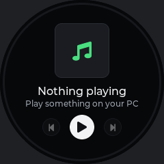<br />Nothing playing</td>
  </tr>
</table>

### Counter

A small example app. It opens at 0 and counts up by one for each click to the right and down by one for each click
to the left, never below 0. The number is drawn as big as fits in the middle of a ring that fills once every 20
counts; each new lap fills in a new random bright colour over the last one.

<table>
  <tr>
    <td align="center">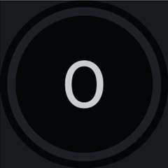<br />Start</td>
    <td align="center"><br />25: the second lap</td>
  </tr>
</table>

### Settings

The knob's own settings: Display (brightness, screen timeout), Lights (LED brightness and mode), Connection (USB,
Wi-Fi setup) and About. Knob Hub's Settings page has them too.

<table>
  <tr>
    <td align="center">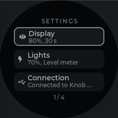<br />Settings</td>
    <td align="center">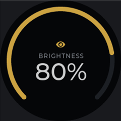<br />Screen brightness</td>
    <td align="center">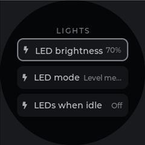<br />Lights</td>
    <td align="center">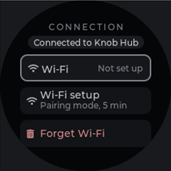<br />Connection</td>
  </tr>
</table>

### Alerts and messages

<table>
  <tr>
    <td align="center">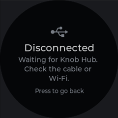<br />Knob Hub disconnected</td>
    <td align="center">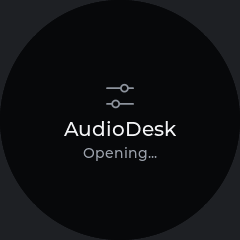<br />Opening an app</td>
    <td align="center">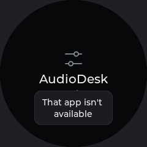<br />A toast</td>
  </tr>
</table>

Every screen, state and message is in [`design/screenshots/`](design/screenshots), grouped by app.

### Using the knob

| Do | On Home | Anywhere else |
|---|---|---|
| Turn | Next or previous page | Change the selected value or item |
| Press | Open the page | Select or toggle (in AudioDesk, move between controls) |
| Long press | | Back |
| Tap | | Tap a control |
| Swipe left / right | Turn pages | Swipe right: back |

## Knob Hub on the PC

Knob Hub lives in the tray. Its window has three pages, and works without a knob: the preview is then a virtual knob.

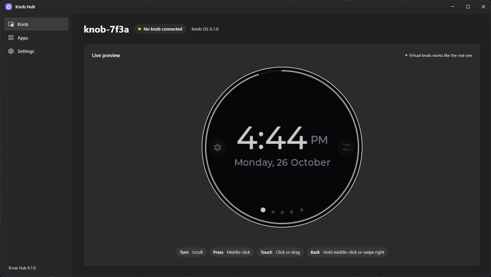

**Knob:** the knob's name, whether it's connected, and a **live preview** of its screen. While a knob (or the
simulator) is connected, the preview mirrors it, and what you do in the preview happens on the knob. Scroll to turn,
middle-click to press (hold for back), click or drag to touch, swipe right for back.


**Apps:** everything on the knob's Home ring, in order, Clock and Settings included. Drag a row to move it (Home
starts on the first one), turn apps on or off the knob, change their settings (e.g. AudioDesk's volume step or the
clock's 12/24-hour format), and remove plugins.

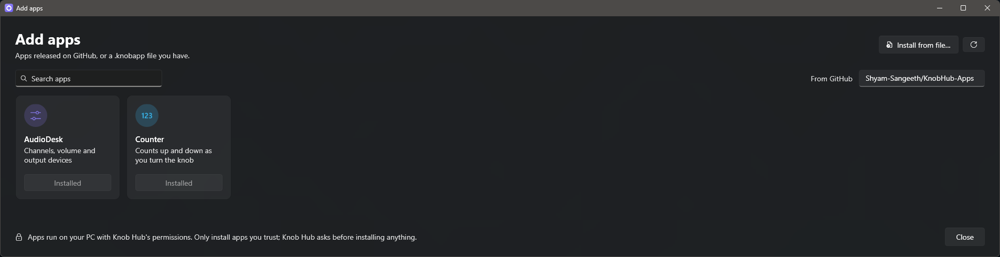

**Add apps** (on the Apps page) opens over Knob Hub and lists the apps released on GitHub, as tiles, with search.
Install or update one from the list, or use **Install from file...** for a `.knobapp` you have. Knob Hub asks before
installing anything, because apps run with Knob Hub's permissions: only install apps you trust.

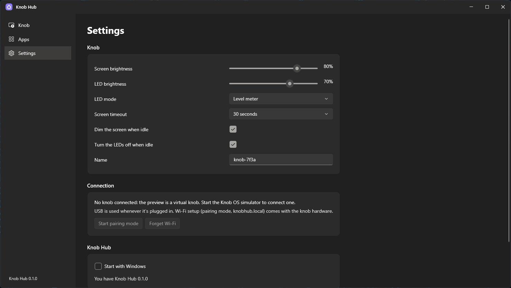

**Settings:** the knob's screen and LED brightness, LED mode, screen timeout, idle behaviour and name, the
connection, and Start with Windows.

## Apps

| App | What it does | Where it comes from |
|---|---|---|
| Media | Now playing in Windows, playback controls | Built into Knob Hub |
| AudioDesk | AudioDesk's channels, volume, Sonar and output devices | [KnobHub-Apps](https://github.com/Shyam-Sangeeth/KnobHub-Apps) (source in `hub/Plugins/AudioDesk`) |
| Counter | Counts up and down as you turn | [KnobHub-Apps](https://github.com/Shyam-Sangeeth/KnobHub-Apps) (source in `hub/Plugins/Counter`) |

Apps are released in their own repository, [Shyam-Sangeeth/KnobHub-Apps](https://github.com/Shyam-Sangeeth/KnobHub-Apps),
apart from Knob Hub's releases. Each release there is one version of one app, tagged `<id>-v<version>`, with
`<id>.knobapp` and `<id>.app.json`; Add apps lists the newest of each. To publish, run
`hub/Plugins/pack-release.ps1`: it builds every app in `hub/Plugins` and releases the versions not released yet
(it needs the GitHub CLI, logged in). Bump `version` in an app's `app.json` to publish an update.

## Making an app

An app is a Knob Hub plugin: a folder with `app.json` and a .NET assembly, zipped and renamed to `.knobapp`. Knob
Hub installs it into `%LOCALAPPDATA%\KnobHub\Apps\<id>`. `hub/Plugins/Counter` is a small, complete example.

**`app.json`:** `id`, `name`, `subtitle`, `description`, `icon`, `color`, `version`, `author`, `assembly` (the DLL's
file name) and `type` (full name of the `KnobApp` subclass).

**The app** derives from `KnobHub.Sdk.KnobApp`: override `Open` to show the first screen and `Input` to react
(optionally `Start`, `Stop` and `Closed`). It talks to the knob through `IKnobHost`: `Show`, `Update`, `Close`,
`Toast` and `Log`.

**Screens** are templates the knob already knows:

| Screen | For |
|---|---|
| `DialScreen` | One big value |
| `TilesScreen` | Up to three round tiles with pills (AudioDesk's channels) |
| `ListScreen` | Rows |
| `ControlsScreen` | A value with a toggle and a picker (an AudioDesk channel) |
| `RingScreen` | A number in the middle of a full ring, drawn as big as fits (Counter) |
| `MediaScreen` | Now playing |

**Icons** are names. Knob Hub has common ones built in (music, play, pause, game, headphones, speaker, volume, mic,
tv, settings, clock, lights, wifi, star, heart and more). Add your own by overriding `Icons`: name to
`KnobIcon.Glyph(text, font)`, `KnobIcon.Image(pngBytes)` or `KnobIcon.Path(svgPathData)`. Knob Hub draws them at the
size the knob asks for. Names are shared between apps, so prefix yours (e.g. `myapp.logo`).

**Settings:** override `Settings` to list them (`AppSetting(id, label, options, default)`, a drop-down of options).
Knob Hub shows them on the app's row on the Apps page and saves the choice in `settings.json`. Read the chosen
option's index with `Host.Setting(id)`; `SettingChanged(id)` is called when it changes.

Build with `dotnet build -c Release`: it produces `bin\Release\<name>.knobapp`, ready for **Install from file...**

## Designs

[`design/recreated/`](design/recreated) has every knob screen recreated by hand in HTML and CSS, one page per app
(home, audiodesk, media, counter, settings, system), drawn at 2x from the screenshots in
[`design/screenshots/`](design/screenshots) with Knob OS's colours and font (Montserrat). They're editable starting
points for new screens and apps. Download a page and open it in a browser to see it (GitHub shows the source).

## Building and running

### Simulator

Prerequisites:

- PlatformIO
- SDL2 MinGW development package unpacked to `%USERPROFILE%\.tools\SDL2\SDL2-2.30.9` (from
  https://github.com/libsdl-org/SDL/releases, file `SDL2-devel-2.30.9-mingw.tar.gz`)
- 64-bit MinGW gcc in `%USERPROFILE%\.mingw64\bin`

In `knob-os`:

```bash
pio run -e sim -t exec
```

Build output goes to `%USERPROFILE%\.cache\knob-os`. In the simulator, the mouse wheel turns, middle click presses
(held half a second = back), the left button touches (tap, swipe), and swiping right goes back.

### Knob Hub

In `hub`:

```bash
dotnet build KnobHub\KnobHub.csproj
KnobHub\bin\Debug\net10.0-windows10.0.19041.0\KnobHub.exe
```

Building Knob Hub also builds `knob_preview.dll` (`pio run -e preview`) if it's missing and copies it next to the
app. Knob Hub connects to the simulator on 127.0.0.1:5718 and retries every 2 seconds.

### The real knob

```bash
pio run -e crowpanel
```

builds Knob OS for the CrowPanel. The board-specific parts (display, touch, encoder, LEDs, USB and Wi-Fi) are still
to be written; see [Status](#status).

### Fonts

`knob-os/fonts/make_fonts.py` builds `src/core/fonts/knob_font_*.c` (Montserrat Medium, LVGL symbols, Latin-1,
Latin Extended-A and typographic punctuation) and digits-only fonts for big numbers
(`knob_font_digits_36/60/72/96`) with `npx lv_font_conv@1.5.3`. It needs Node.js.

## Files

- Settings: `%LOCALAPPDATA%\KnobHub\settings.json`
- Installed apps: `%LOCALAPPDATA%\KnobHub\Apps\<id>`
- Log: `%LOCALAPPDATA%\KnobHub\knobhub.log` (connections, apps opened, app problems)
- The simulator's kept data, its stand-in for the knob's flash: `%LOCALAPPDATA%\KnobHub\Simulator\` (`apps.json`,
  `icons.bin`). The real knob keeps the same files in its flash.

## Connection

USB serial and Wi-Fi aren't written yet. The plan:

- The first time, USB only (it pairs the knob with Knob Hub).
- USB always has priority when plugged in.
- Otherwise Wi-Fi, once set up.
- Wi-Fi is set up from the knob's Settings > Connection > Wi-Fi setup: in pairing mode the knob opens its own network
  and a setup page at knobhub.local, which switch off again once it's connected.

## Repository layout

```
KnobHub/
├─ knob-os/                 Knob OS firmware (PlatformIO, LVGL 9.2, C++17)
│  ├─ src/core/             Shared UI and logic: Home ring, templates, settings, link, icon cache
│  ├─ src/hal/sim/          Simulator (SDL2 window)
│  ├─ src/hal/preview/      knob_preview.dll for Knob Hub's live preview
│  ├─ src/hal/esp32/        The real knob (to be finished with the board)
│  └─ fonts/                make_fonts.py
├─ hub/                     Knob Hub (WPF, .NET 10); KnobHub.slnx
│  ├─ KnobHub.Sdk/          Class library for apps
│  ├─ KnobHub/              The tray app
│  └─ Plugins/              AudioDesk and Counter apps, pack-release.ps1
├─ design/
│  ├─ screenshots/          Every knob screen, by app
│  └─ recreated/            The screens recreated in HTML/CSS, one page per app
└─ docs/screenshots/        Knob Hub screenshots for this README
```

## Status

Working: the simulator, Knob Hub with the live preview, apps from GitHub, and the Media, AudioDesk and Counter
apps. Next: the USB and Wi-Fi connection and the real board.
